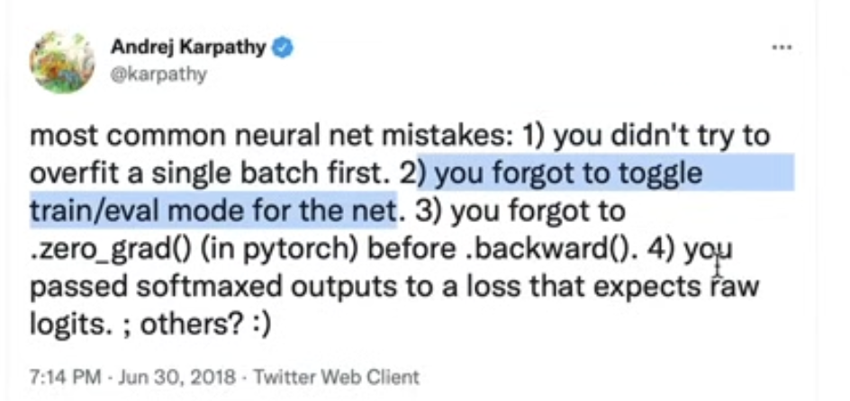

1. backpropagation: chain rule of the derative.
basic: add: fly over; mul: Cross-multiplication
但是在反向传播计算梯度的时候， 对于每一个神经元需要累积， 因为如果不累计， 这个神经元可能会经过多个反向传播的路径从而被override.

2. 在训练神经网络的时候， 在做backward计算梯度的时候要先清除所有的神经元里面的梯度， 不然这些神经元里面的梯度会一直累积

